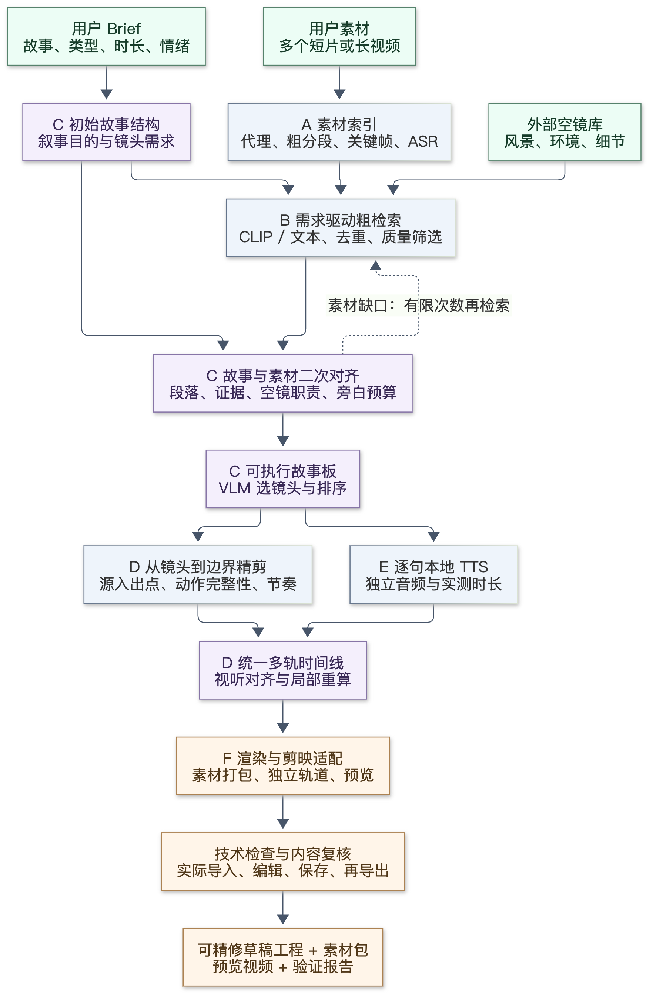
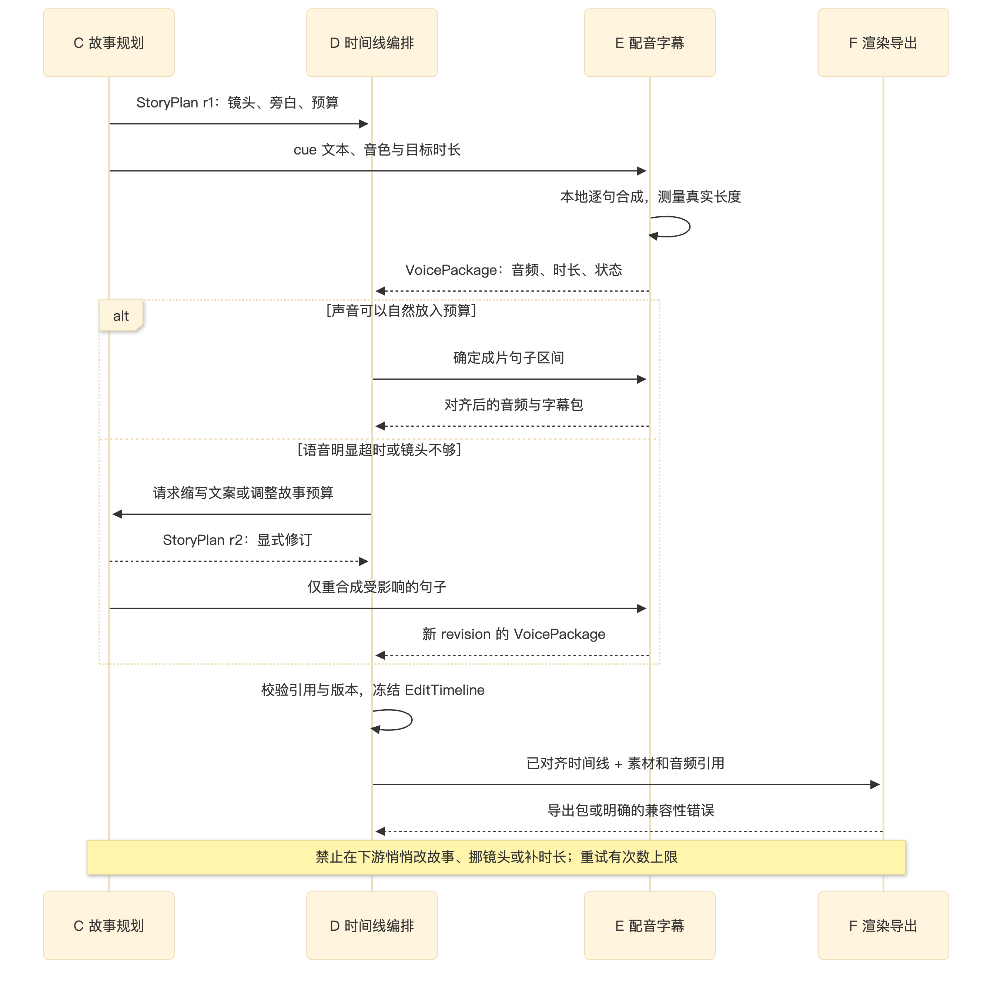
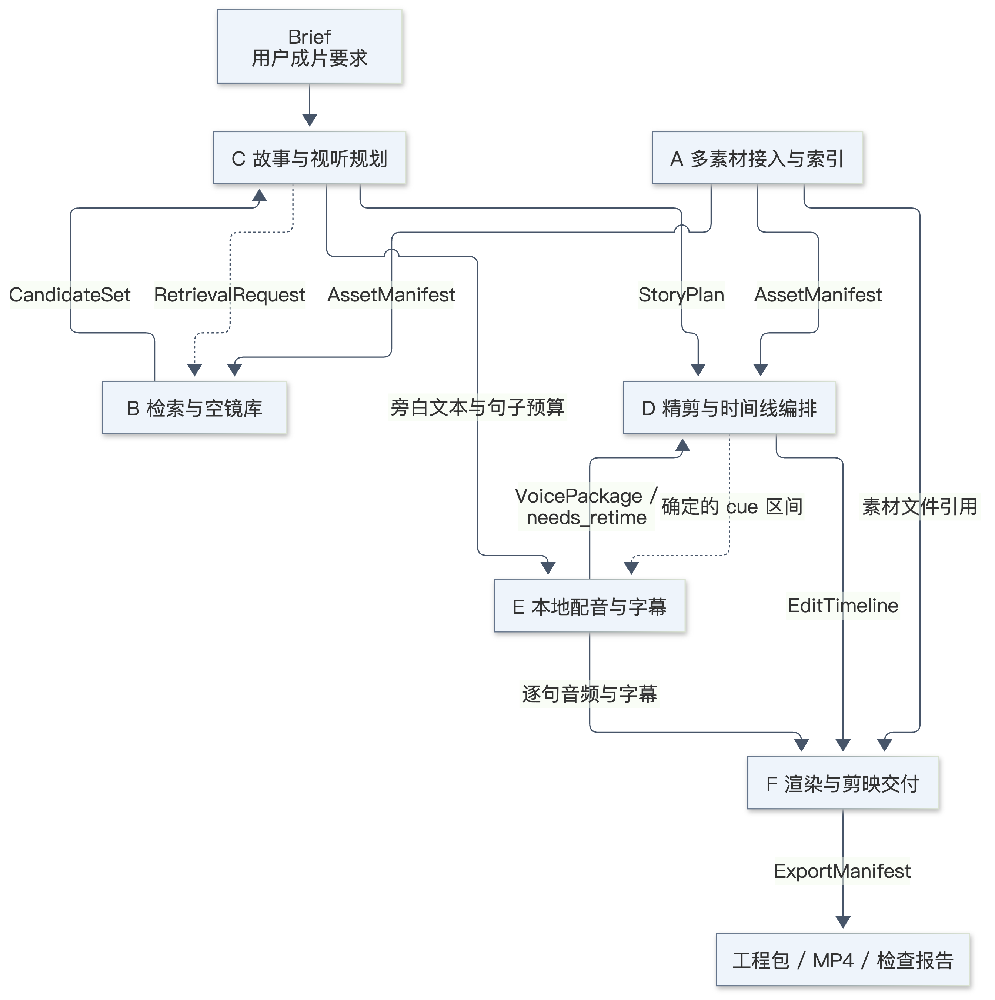

# QuickCut 项目指导文件：从多素材粗筛到可精修视频工程

版本：团队设计稿 v0.1 · 更新日期：2026-11-06（Asia/Taipei）

代码审计基线：`6cb978d` · 仓库：<https://github.com/Tt200411/QuickCut>

本文件面向全部六位参与者，也是需求、研发、测试和交接的共同入口。先读工作流，再读自己的任务书，最后按数据协议实现。团队成员可以直接引用文中的任务、表格、流程图和示例用于分工、Issue、PR 和讨论；这份说明不改变原仓库或第三方素材、模型的授权条款。

**状态约定：**“已实现”有当前代码支撑；“已验证样例”只指特定素材和配置；“目标设计”是接下来共同实现的能力；“待验证”需要实验或目标软件实机确认。下文的完整多素材工作流是目标设计，不是现有 MVP 已经全部具备的功能。

## 读者导航

| 你需要做什么 | 阅读入口 |
| --- | --- |
| 先理解我们在做什么、为什么这样分层 | 本文第 1–4 节 |
| 确认当前代码能做什么，避免重复开发 | [MVP 基线与复用地图](team/mvp-baseline.md) |
| 领取自己的实现任务、明确边界和交付 | [六人任务书](team/workstreams.md) |
| 独立开发、对接上下游、处理版本与时间 | [模块协议与迁移设计](team/contracts.md) |
| 立即使用一套一致的模拟输入输出 | [黄金协议样例](../examples/team_contracts/README.md) |
| 复现已经审阅的中文视频样例 | [中文样例说明](chinese-summary.md) |
| 复用和修改图 | [总体工作流](../figures/quickcut-coarse-to-fine.md)、[交付图](../figures/quickcut-team-handoffs.md)、[配音时序图](../figures/quickcut-voice-retiming.md) |

## 1. 我们共同交付的产品

用户可能上传一条十分钟视频，也可能上传二十个手机短片：出发、车窗、步行、朋友互动、吃饭和休息。用户首先给出成片要求，例如：“做一条一分钟内的中文 VLOG，从城市出发，到山里慢慢放松；开头紧凑，结尾安静，保留现场环境声。”

系统应围绕这个要求整理素材、判断哪些事件有画面支持、安排能交代环境或承接情绪的外部空镜，并把它们组成可理解的故事。配音与字幕同样围绕故事编排。用户最终拿到可以在剪映继续精修的工程：可以替换一个镜头、延长一个空镜、换一句配音、调低音乐，而不必重做全部内容。

交付核心是**可编辑工程和素材包**；预览 MP4、时间线 JSON、配音文件、字幕及检查报告作为配套产物。第一阶段把“模板”定义为可编辑草稿工程；“任意更换素材后自动复用的模板商品”需要额外的占位符和约束设计，不属于首轮验收。

### 1.1 已确认的产品要求

- 输入支持多个短视频、一个长视频，以及两者混合；保持每个片段到原文件的可追溯关系。
- 用户故事、类型、风格、时长在开始时输入，参与粗筛；粗筛后依据实际素材进行一次故事与素材的二次对齐。
- 外部空镜库参与环境建立、转场、情绪留白和结尾设计。具体人物和事件仍以用户素材证据为依据。
- 支持 VLOG 和微电影式叙事，允许旁白、内心独白和现场原声的不同组合。
- 视觉理解、ASR、文案生成与 TTS 在本地运行。“外部素材/配音”是相对于原始视频而言，不表示云端推理。
- 从素材级、事件级、镜头级逐步走向边界级；高成本视觉分析只用于值得保留的候选。
- 剪映工程中保留独立画面、原声、旁白、字幕和必要的音乐/音效轨。预览可以烧录字幕，工程里的字幕仍须可编辑。
- 第一轮端到端验收先沿用现有 5–60 秒预算；更长视频放在后续扩展，不靠重复镜头或空洞文案凑时长。

### 1.2 首轮范围与扩展范围

| 首轮必须闭环 | 后续扩展 |
| --- | --- |
| 多文件导入、可追溯候选、实际语义检索 | 大规模向量库、跨项目素材服务 |
| 主素材与空镜联合规划、三段基本故事结构 | 复杂非线性叙事、更多风格策略 |
| 本地旁白、逐句字幕、原声保留 | 多角色对白、声音克隆、口型同步 |
| 可编辑时间线、基础硬切、可调整音量 | 复杂转场、特效、自动作曲与高级调色 |
| 指定版本剪映实际打开、编辑、保存、再导出 | 多剪辑软件适配和通用模板系统 |

首轮应使用一个可工作的编排链路，而不是六个彼此独立的演示程序。系统主动标出缺少证据、配音超时和导出不支持的功能，比生成表面完整、实际无法继续编辑的结果更重要。

## 2. 由粗到细：先确定值得讲的内容，再精确决定哪里切

“粒度”描述我们正在处理的单位，“阶段”描述正在做的事情，两者需要区分。一个素材可能在粗筛时已经被淘汰，不必再做逐帧动作分析。

| 粒度 | 处理对象与目的 | 主要方法 | 输出与负责人 |
| --- | --- | --- | --- |
| **L0 素材级** | 完整文件；确认格式、可解码性、重复文件、横竖屏、时长与原声 | FFmpeg/ffprobe、哈希、稀疏抽帧、代理生成 | A 的资产目录与质量信息 |
| **L1 场景/事件级** | 一次活动、一个场景、一段完整讲话；确定故事素材范围 | 场景边界、ASR 段落、时间与视觉相似性、必要的 VLM 概括 | A 的分段和 B 的候选分组，C 确认叙事用途 |
| **L2 镜头级** | 同一事件的多个视角；保留关键动作，去掉重复覆盖 | CLIP/文本召回、质量排序、VLM 比较、故事约束 | C 的故事板与镜头选择 |
| **L3 边界级** | 被选镜头附近的帧和音频；定位入点出点 | 局部密集采样、镜头切换、动作变化、语音停顿 | D 的精剪区间 |

场景边界是画面的变化；事件边界是语义活动的变化，两者不必一致。长视频需要逐层拆分，短视频可先整体作为候选，必要时再拆。一个事件也可能由多个源文件共同表达，不能把文件顺序默认当作故事顺序；拍摄时间、地点等缺失时应显式保持未知。

现有 MVP 的“每 3 秒一个窗口、抽中点关键帧”可作为 L0/L1 的基线，不应直接宣称具备场景识别。下一阶段先引入可替换的分段器，再对入选区间增加多帧分析。采样密度、窗口长度、候选数量都是配置，应记录其效果和成本后再冻结。

## 3. 完整目标工作流，以及每条箭头意味着什么

图的可编辑 Mermaid 源文件见 [quickcut-coarse-to-fine.mmd](../figures/quickcut-coarse-to-fine.mmd)。所有模块之间传递的是结构化数据和媒体文件引用，不是只靠一段自然语言约定。

### 阶段 1：需求与素材分别进入系统

C 把用户要求转成 `Brief`：故事意图、成片类型、时长预算、语言、画幅、节奏、旁白偏好、必须保留的事件。A 同时处理素材，生成 `AssetManifest`。用户信息和模型推测分开存储；例如“是同一个地点”不能仅因为两张图都是绿色就作为事实写入。

外部空镜库也必须有资产 ID、可定位文件、长度、画幅和来源记录。B 负责库的检索与语义标签，通用媒体探测与抽帧能力复用 A，避免两套素材规范。

### 阶段 2：初始故事驱动粗筛

C 先提出叙事段落及其需要表达的内容，再向 B 提交 `RetrievalRequest`。B 从用户素材召回能支撑事件的画面，从外部库召回能承担空镜职责的画面。候选保留相关性、质量和来源，不直接把最高分镜头排进成片。

例如“抵达山里”可能需要用户下车的主镜头，再接环境空镜。空镜可以表达氛围；未经证据支持，不把外部山景描述成用户确实抵达的具体山峰。

### 阶段 3：故事—素材二次对齐

C 将“用户想讲什么”“实际拍到了什么”“空镜库能补充什么”放在一起，调整段落、篇幅和镜头职责。这是第一轮故事可执行性检查：哪些事件有证据，哪些只能用旁白表达主观感受，哪些需要调整叙述，哪些需要继续检索。

这一阶段的输出是 `StoryPlan`，每段至少有叙事目的、证据片段、主镜头、空镜位置及职责、时间预算、旁白文本和未解决缺口。空镜安排是主动的结构设计，不只是发现素材不足后的补片。

| 段落示例 | 主素材用途 | 空镜用途 | 声音安排 |
| --- | --- | --- | --- |
| 出发 | 收拾背包、上车，建立人物行动 | 城市环境或车窗细节 | 简短旁白，保留关车门或街道声 |
| 探索 | 步行、交流、观察，推动事件 | 林间光影、溪流，连接不同视角 | 旁白与现场声音交替 |
| 放松 | 坐下休息、人物表情，完成情绪变化 | 稍长的环境画面，承接结尾 | 放缓语速，留出原声 |

再检索是有上限的循环。建议 P0 同一缺口最多检索三轮（首次检索加两次修订后的再检索），仍未满足则返回具体缺口给用户或人工编辑；该上限是待团队确认的策略值，不是现有代码行为。配音适配另按协议限制为同一句最多两轮。

### 阶段 4：VLM 镜头选择与 D 的精剪

C 把有限的真实候选关键帧、编号、源时间、ASR 证据和段落目标交给本地 VLM。它提出选镜头和排序。程序检查素材 ID、来源、重复、事件覆盖和时长，再由 D 细化入出点。

程序改变了模型顺序、人工锁定了必选镜头、或重写了旁白，都要记录来源与理由。模型能生成合法 JSON 只说明输出格式合法，不证明角色、动作和因果关系正确。关键事件要有画面对照验证。

D 可以裁掉准备动作或冗余等待，但需要保留让观众理解事件的最小上下文。切换两个视角时检查动作、方向和声音；遇到动作证据不足时保留较完整区间，不仅依据一张中点图片切断事件。

### 阶段 5：配音参与时间安排

C 负责说什么，E 负责声音如何生成以及真实长度，D 负责它在成片中的位置。旁白、内心独白、现场对白和纯环境声段落都应有明确标识。

E 按句生成独立音频，清理边界静音并测量时长。对于已经审阅的画面区间，配音应在自然语速范围内适配；明显超时则返回 `needs_retime`。D 可以调整镜头、空镜或段落预算，文案需要缩写则交回 C。字幕由实际播音文本及确定的时序生成，不使用 ASR 猜测结果作为最终字幕原文。

图中的 revision 表示实际内容版本。旧旁白包不能直接覆盖新故事板；修改一句话只重做这句话及受影响的字幕，避免无意义重跑整个视频。全局镜头时间只由 D 更新。

### 阶段 6：生成工程与预览

F 读取冻结版本的 `EditTimeline`、`VoicePackage` 和素材引用，输出预览 MP4 和剪映工程包。两者从同一份时间线生成，避免预览与工程出现不同镜头或不同配音时序。

工程保留独立轨道和媒体引用，预览允许烧录字幕。工程中只导入一个已经混音、烧字幕的 MP4 不满足验收。目标剪映版本、操作系统、工程放置/导入方式、素材重定位方式必须先由 F 实机确认。

### 阶段 7：技术与内容两类验收

技术检查覆盖解码、时间戳、时间区间、音轨存在性、原声保留、包内路径和剪映可编辑性。内容检查覆盖人物动作、因果顺序、空镜职责、旁白是否对得上当时画面、故事有没有结果。`PTS=0` 和“ASR识别到最后一秒”不能替代内容检查。

## 4. 技术架构与最小选型

第一阶段沿用 Python 主工程和现有本地模型，把业务能力拆成清楚的 Python 模块与可独立运行入口。FastAPI/Uvicorn 负责请求与任务状态，Gradio 负责轻量工作台；它们不是模型推理框架。先做单机模块化架构，不要求六位同事各搭一个网络服务。

媒体文件保存在本地项目目录，结构化记录先使用版本化 JSON。任务记录、缓存索引可按需要引入 SQLite；没有必要为首轮验证先部署向量数据库和复杂消息队列。Ollama、ASR 和渲染任务由 D 的编排器限制并发，避免多人同机调试同时耗尽内存。

| 模块 | 当前可复用基线 | 下一阶段最低技术方案 | 负责人 / 状态 |
| --- | --- | --- | --- |
| 探测、代理、抽帧 | FFmpeg、imageio-ffmpeg；关键帧缓存 | 使用 ffprobe 完整采集媒体参数；增加多资产与代理时间映射 | A / 多资产待实现 |
| 粗分段 | 固定 3 秒窗口 | 固定窗口保持基线；评估 PySceneDetect Content/Adaptive 场景边界，再结合 ASR 分段 | A / 场景检测待验证 |
| 视觉检索 | 默认颜色直方图；可选 OpenCLIP adapter（MobileCLIP-S2 / datacompdr） | 冻结可用权重；对中文查询做实测，必要时本地查询改写或评估多语言编码器 | B / adapter已有，语义效果待验收 |
| 原声 ASR | faster-whisper tiny、CPU int8、VAD | 保留本地缓存；需要更高准确率时比较 small，记录实测延迟 | A / 已实现 |
| 视觉故事规划 | Qwen2.5-VL 3B、Ollama、带编号接触表与 JSON 约束 | 分段/分幕调用、完整证据映射、显式校验与有限纠正 | C / 基线已实现，通用多素材待实现 |
| 时间线 | 现有 Python dataclass、单一 source_video | 多资产 IR、整数微秒、独立轨道、修订关系与局部失效 | D / 升级待实现 |
| 本地 TTS | macOS say，中文 Reed、rate 145，逐句 WAV；espeak兜底 | 先保留本机基线；跨平台或情绪能力由 E 用同文小样评估后另行冻结 | E / 本地基线已实现 |
| 字幕与混音 | SRT、FFmpeg/libass、PCM 中间音频、独立旁白 | 保留可编辑字幕和独立音频资产；混音参数进入时间线 | E/F / 多轨契约待扩展 |
| 剪映导出 | 无 | 先最小工程实机验证，再实现版本化 exporter；无效或不支持时明确报错 | F / 待验证与实现 |

选型依据：Qwen 的官方模型卡确认了所用 3B 视觉语言模型；Ollama 的本地生成接口支持图像输入和 JSON Schema 输出。我们沿用当前能运行的组合，不把更换最新模型作为多素材改造的前提。[Qwen 官方模型卡](https://huggingface.co/Qwen/Qwen2.5-VL-3B-Instruct) · [Ollama Generate API](https://docs.ollama.com/api/generate)

OpenCLIP 为图像和文本提供编码与相似度计算，具体中文检索能力需要项目样例验证；ASR 使用的 faster-whisper 基于 CTranslate2。PySceneDetect 的 Content/Adaptive 检测器是场景切分候选，不等同于完整事件理解。[OpenCLIP 官方仓库](https://github.com/mlfoundations/open_clip) · [faster-whisper 官方仓库](https://github.com/SYSTRAN/faster-whisper) · [PySceneDetect 检测器文档](https://www.scenedetect.com/docs/latest/api/detectors.html)

### 4.1 当前 MVP 与目标的差距

当前审阅过的中文样例由单个源视频选出 20 个窗口，形成 58.5 秒结果，使用 39 张候选关键帧、分幕 Qwen 调用及人工润色的 11 句中文旁白。索引的实际 encoder 是颜色直方图，不是 CLIP。样例中的三幕候选区间及部分必选事件也来自人工审阅。

2026-11-06 对基线运行 `.venv/bin/python -m pytest -q` 得到 **82 passed**。这些测试证明现有功能的回归结果，不证明目标多素材流程或剪映导出已经完成。

必须优先补齐的工程缺口：

1. `Timeline.source_video` 是单文件字段，不能仅靠增加一个文件列表就支持跨素材裁切。
2. 当前 `asset_id` 在旧时间线中常实际表示 shot ID；新协议要拆清资产 ID 和片段 ID。
3. Gradio 的索引检索入口没有完整调用分幕 Qwen 规划；镜头编辑后也没有完整失效重算。
4. 通用 `basic` 路径和已审阅中文脚本的规划、校验、保存顺序不同，不能混为同一个已验证工作流。
5. 某些 CLI 路径先写时间线文件再生成 TTS，可能漏掉合成后更新的实际字幕时序；新流程必须在最终对齐后保存同一 revision 的交付记录。
6. 剪映工程格式、目标版本与可编辑性尚未验证，不能写成“已有通用导出标准”。

完整源码引用与命令见 [MVP 基线](team/mvp-baseline.md)。

## 5. 六人职责与协作方式

| 同事 | 一句话职责 | 交付什么 | 主要消费者 |
| --- | --- | --- | --- |
| **A** | 把原始文件变成真实、可定位的素材事实 | AssetManifest、代理、关键帧、ASR、缓存 | B、D、F |
| **B** | 从用户素材和空镜库召回合适候选 | CandidateSet、检索入口、候选解释 | C |
| **C** | 决定故事表达、镜头职责和旁白内容 | StoryPlan、检索请求、模型推理记录 | B、D、E |
| **D** | 把故事编译成统一的成片时间安排 | EditTimeline、编排入口、编辑与局部重算 | E、F |
| **E** | 生成本地声音并报告实际时长 | VoicePackage、逐句音频、字幕与对齐状态 | D、F |
| **F** | 忠实执行时间线并交付可精修工程 | ExportManifest、剪映包、预览、验证报告 | 用户、全组 |

每个人都写自己的模块测试；D 维护编排和协议联调，F 维护导出兼容性与媒体执行验收。六位同事分别拥有模块，不代表全组测试、运行和修复都交给最后一个人。

### 5.1 权责原则

- A 负责粗分段与源时间事实，D 负责入选区间的精剪。B 可以筛选和排序候选，但不擅自写最终成片时间。
- C 是故事及文案内容负责人；E 可以规范发音和标点，对事实/剧情的修改回交 C。
- D 是最终时间线的唯一编排者；E 提供声音事实，F 按时间线执行。
- F 遇到目标工程不支持的效果返回明确能力差异，不自行删字幕、烧平轨道或改故事。
- UI 初期复用现有 Gradio，由 D 接编排状态与编辑入口，F 接预览/工程下载；各模型同事不另做一套界面。
- 共享数据协议由相关生产者和消费者共同确认；D维护时间线协议，F负责确认其可导出性。

逐人 P0/P1、第一天任务、验收清单、跨模块问题负责人及交接模板见 [六人任务书](team/workstreams.md)。

## 6. 独立并行开工：先统一合同，再替换真实上下游

先使用 [黄金协议样例](../examples/team_contracts/README.md)，它提供可解析的模拟数据，不包含可播放媒体，也不是当前 QuickCut CLI 已支持的新输入格式。这样 B 不需要等 A 完成所有索引，E 不需要等 C 完成所有模型规划，F 不需要等真实模型稳定。

**共同字段规则：**所有对象带协议版本、项目标识和修订信息；ID 区分 project、asset、segment、beat、cue、track；时间使用整数微秒，源时间与成片时间分开；区间采用左闭右开 `[begin,end)`；媒体以项目根目录下的相对引用交付，导出时重新定位。确切字段以 [协议文档](team/contracts.md) 和样例为准。

先约定四类失败的归属：没有候选交回 C；没有真实关键帧交回 A；配音超时交回 D/C；工程不兼容交回 F。重试要写明次数、使用的输入版本、变化内容和最终状态，不允许无限循环或静默降级为“成功”。

### 6.1 第一轮任务，不需要等待别人完成

| 同事 | 立刻可做的事情 | 第一份交接 |
| --- | --- | --- |
| A | 用 3 个短片、1 个长片和 2 个空镜验证导入 | 可追溯 Manifest 和预览关键帧 |
| B | 用样例 Manifest 与手写请求实现召回 | 用户镜头和空镜分开的 CandidateSet |
| C | 用固定候选和 Brief 输出故事板 | 有证据、预算和缺口的 StoryPlan |
| D | 用手写故事板编译多轨时间线 | 时间校验通过的 EditTimeline |
| E | 用手写句子完成本地 TTS | 独立 WAV、实测时长和字幕 |
| F | 用手写时间线做最小剪映工程 | 两个视频、可编辑文字、独立音轨的实机记录 |

F 的实验必须最早进行，记录剪映版本、系统、操作步骤与失败原因。生成了一个 JSON 文件不等于能在剪映打开；目标软件版本是否支持，必须以实机结果为准。

### 6.2 三次汇合与共同里程碑

| 里程碑 | 可以宣布完成的条件 |
| --- | --- |
| **M0 协议与准备** | 相关同事确认 v0.1 输入输出；黄金样例可校验；确定目标剪映版本；有每人可独立运行的开发入口 |
| **M1 模块独立** | 每个模块通过自己的标准样例，返回正确数据或明确失败；F 已实际验证最小可编辑工程 |
| **M2 真实串联** | 多源素材＋外部空镜＋Brief 经真实检索、规划、TTS、时间线和导出生成一个完整工程；所有产物引用一致 |
| **M3 编辑闭环** | 替换、重排、改单句配音会触发正确局部重算；剪映打开、编辑、保存、再导出；用户可以接手精修 |

这些是验收顺序，不是未经估算的日历承诺。各人完成 M0 实验后再估算工期和机器资源；剪映格式验证与模型中文效果验证应作为最先暴露的外部不确定项。

## 7. 验收：需要看到什么证据

| 类别 | 最低验收内容 | 主责 |
| --- | --- | --- |
| 素材 | 混合长短、横竖屏、含音轨/无音轨均可处理；重复文件可识别；所有区间回到正确源文件 | A |
| 检索 | 中文/英文语义请求、ASR请求、空镜请求各有人工标注相关集合；记录召回与排序，不能只证明返回了列表 | B |
| 故事 | 每个关键事件有素材依据；空镜职责明确；无素材缺口被隐瞒；旁白没有角色颠倒或虚构结局 | C |
| 精剪 | 不越源边界、不出现非法同轨重叠；动作和话语有完整上下文；时间修改能追溯和撤销 | D |
| 声音 | 中文可懂、音色符合样例目标、单句可重做；文字与播音一致；超时可反馈；结尾不被截断 | E |
| 渲染 | 全量解码无错误；画面正常；时间戳一致；原声保留；旁白清楚；限制峰值 | F |
| 工程 | 在明确版本剪映中打开；可分别修改画面、文字、配音、音量；素材包移动后能重定位；保存后再次打开与导出 | F，D配合 |
| 闭环 | 修改一个镜头或一句旁白后，旧缓存不会错误覆盖新 revision，只有依赖该修改的部分重算 | D，所有相关模块配合 |

每轮使用三类真实测试集：单长视频、多短视频、长短混合；并覆盖无对白、画幅混合、候选不足、空镜不匹配、语音超时、最后一句、用户修改和素材路径变化。协议黄金样例只测试数据关系，不能替代真实媒体和剪映实机验收。

检索质量阈值、VLM语义正确率、自然语速范围和性能预算，应在标准测试集上实测后由模块负责人提出，再由消费者确认。不要把未测量的吞吐率、模型能力或自然度评分写为既定保证。

## 8. 从现有代码迁移，而不是一次性重写

1. **先增加新数据模型与旧格式适配器。** 旧时间线保持可读，新多素材时间线显式区分 asset 和 segment。用现有单源结果做回归基线。
2. **把单文件媒体能力抽成可重用函数。** A 扩展资产目录，F 让渲染按片段自己的 asset 引用取文件；代理与源文件时间映射由 A/D共同验证。
3. **为 B/C/E 加稳定输入输出边界。** 模型推理逻辑可以复用，但其输出必须经契约校验；不要让下游直接解析模型自由文本。
4. **让 D 管理修订、依赖和最终保存顺序。** 故事、音频和字幕对齐后保存最终版本，供预览与工程共享。
5. **F 先验证最小工程，再扩大轨道能力。** 支持矩阵说明哪些对象可原生编辑、哪些不支持；无法满足基础轨道要求时不能宣布工程交付完成。
6. **把样例脚本中有效的验证方法逐步收回模块。** 保留原始模型响应和人工修订来源，把“对一个视频手工调通”转换成可重放的通用过程。

建议避免六人同时大改 `core.py`。各人新建职责明确的小模块，调用现有能力；D维护编排接口，最后做少量集成修改。代码落点的细化建议见各任务书，不代表这些目录现在已经存在。

## 9. 开发、交接与复现约定

- 分支按模块建立，例如 `codex/ingest-multi-source`、`codex/retrieval-broll`、`codex/story-planner`、`codex/timeline-ir`、`codex/voice-package`、`codex/jianying-export`。每次 PR围绕可验收的输入输出变化。
- 提交源码、配置、示例协议和必要的小样；模型权重与大型素材不进普通 Git。素材包需有获取方式和哈希记录，让队友能补齐文件。
- 每个交付包含：版本、输入样例、输出样例、运行命令、测试结果、已知限制、消费者需要调整的地方。
- 当前依赖多为最低版本范围，尚不是锁定的可重复环境；M0记录 Python、操作系统、FFmpeg、Ollama版本、模型标识/权重摘要和依赖清单。不要声称任意平台环境都已验证。
- 开发阶段可以联网安装依赖和下载权重，正式内容推理保持本地；离线测试前先验证缓存完整，不能把首次下载失败当作模型推理失败。
- 使用 CPU/mock 快速检查结构，再按需要调度本地 VLM/TTS 集成测试。共享机器同时跑多个大模型任务时，由 D 的编排配置控制并发，不通过复制更多服务解决资源冲突。
- 当前命令、API以及平台差异以 [基线文档](team/mvp-baseline.md) 为准。新协议样例不直接传给旧版 `quickcut render`。

## 10. 需要记录的设计决策

| 决策 | 当前结论 | 后续如何改变 |
| --- | --- | --- |
| 用户故事何时进入 | 输入时形成初稿，粗筛后做二次对齐 | C 提供新规划策略及对照样例 |
| 外部空镜何时加入 | 粗筛时参与联合召回，二次对齐确定职责，再按缺口补充检索 | 保留其来源和使用目的 |
| 谁修改全局时间 | D 唯一编排，E提供实测，F执行 | 契约变更由相关消费者共同确认 |
| 默认推理位置 | 本地 | 用户要求改变后再新增部署决策 |
| CLIP与VLM关系 | CLIP做召回，VLM做有限候选理解与选择 | 用质量/成本实测决定是否更换实现 |
| 旁白配音方式 | 逐句音频、真实时长、可局部重生成 | 更换TTS引擎不改变VoicePackage |
| 剪映交付形式 | 可编辑草稿＋素材包，先实机验证 | 不预设不存在或未验证的通用格式 |
| 成功的判定 | 技术可执行、故事可理解、工程可精修 | 不能只用JSON通过或MP4存在判定 |

## 11. 术语对照

| 术语 | 在本项目中的意思 |
| --- | --- |
| Brief | 用户希望成片讲什么、给谁看、是什么风格和限制 |
| Asset | 一份可定位的原始媒体文件或生成音频；不同于文件内部镜头 |
| Segment | 某资产上的源时间区间；可能是粗窗口、场景或精剪片段 |
| Event / Beat | 事件是素材中的活动；Beat是成片叙事段落，两者可多对多 |
| B-roll / 空镜 | 用于环境、连接和情绪表达的辅助画面，其来源需要保留 |
| CLIP | 用图文向量相似度召回素材的模型；不负责语音时间同步 |
| ASR | 把原声或验证用音频识别成文字及时间戳 |
| VLM | 结合图像和文字理解候选，提出镜头与故事建议的模型 |
| TTS | 将已经确定的文字合成为声音 |
| IR / EditTimeline | 不依赖剪映私有格式的统一多轨时间线 |
| Exporter | 把统一时间线转换为目标工程和媒体包的适配器 |
| Revision | 一次明确修订版本；用于判断下游声音、字幕、渲染是否过期 |

本文确定共同方向；具体字段以协议为准，任务验收以六人任务书为准，当前已实现行为以代码基线为准。三者有冲突时记录差异并修订，不能把文档目标默认为运行时能力。
